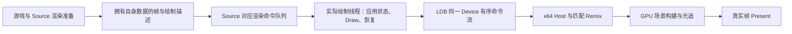

# 大量复用 l4d2-rtx、保留 Source 多线程的实施计划

日期：2026-10-15。状态：方案已开始执行。[P0／P1 基础进展](rt-foundation.md) 已有协议、Device 观察和开发协调器；游戏队列 Hook、完整用户启动器与 RT 接入尚未完成，尚无 B580 光追或游戏并发验收结果。

## 目标与范围

当前研发优先级调整为：暂停扩展内置 FG，复用 l4d2-rtx 的游戏适配和匹配的 Remix 渲染器，实现保留 Source 多线程的光追路线。原有 FG 实验和结果保留。体验目标仍是高压场景维持 60 个真实帧；将来 60→120 的 FG 单独验收。

硬性要求是保留游戏已有的渲染并行能力：正式 RT 配置不能强制 `mat_queue_mode=0`，也不能靠关闭粒子、绳索、细节物体的线程或隐藏这些对象来宣称完成。允许一条有序的 D3D9／GPU 提交链，游戏逻辑、渲染准备及已有工作线程应能并行推进。跨帧重叠、实际工作和等待时间都要有证据。

首个用户测试包只承诺验证静态世界 RT 和材质队列，不冒充完整游戏光追。完整验收还包括感染者、幸存者、武器、蒙皮、粒子、透明、水、灯光、换图与高压性能。地图或插件未覆盖的路径明确列为未验收。

## 已知事实与版本前置项

| 项目 | 已核对版本／事实 | 实施要求 |
| --- | --- | --- |
| 本仓库 | 计划基于 `e1a788161e0539cf33f40a5860c77c96f8bbe04e` | 当前没有新的引擎 RT Hook |
| 当前集成 LDB | `9e3ee1292f901b0bb9352e36bba93a4cd5cfbda4`，见 [baseline](../../integration/ldb/baseline.json) | 保留已验证的版本与构建记录 |
| LDB 远端 HEAD | 本轮 `git ls-remote` 得到 `cafc0442446c502a0de0ebb52d5e73ccaae67516` | 仅确认存在，尚未审查或采用；先比较并发、IPC、资源与加载逻辑差异 |
| l4d2-rtx | `1fc8ded63a8491e9c1972eb2940d6cebbc20ad9e` | 复用规则与场景适配，重构线程相关执行方式 |
| 通用 Remix 研究版本 | `3bde35c3268fe16f4d8075acc7d27340abeb4277` | 只是能力研究参考，尚未选为运行时 |
| 当前 FG DXVK | DXVK 2.6.1 加本项目 FG 修改 | 不能据此宣称支持 Remix RT；RT 使用独立、完整、匹配的运行配置 |

特别注意：l4d2-rtx 使用自定义 render state，例如 149／169／220，源码明确注明部分功能需要 runtime 修改。P0 必须找到对应的 Remix 源码／发布版本并核对这些解释规则，不能直接把 NVIDIA 主分支 DLL 与 mod 混搭。最终固定的是游戏版本、mod、Bridge、Remix、API 和配置的完整组合。

已观察到的风险包括共享 `primctx`、全局视图／区域状态、在 RenderView 和模型 Hook 直接设置 D3D9 状态，以及粒子构造时读取当前 shader 状态并改写顶点。源码审查指出的是需要验证的依赖，尚未在本机复现具体竞态。

## 复用与改造边界

| 模块 | 复用内容 | 必须补齐的工作 |
| --- | --- | --- |
| 游戏语义 | 材质／shader 分类、天空、HUD、武器、灯光、地图可见性规则 | 将规则与直接访问游戏／设备的代码分开；复核游戏版本与 Hook 签名 |
| 绘制转换 | 顶点格式、UV、材质与特殊表面的处理逻辑 | 校验 queued／fast path 是否仍经过对应 Hook，绑定正确的视图和资源版本 |
| 光追后端 | 匹配 Remix 的场景管理、加速结构、光照、路径追踪、降噪 | B580 初始化、shader、扩展和非 DLSS 路径验证；不承诺现成兼容 |
| Bridge／Host | x86→x64 传输、资源 ID、错误日志、原生 Windows 构建 | 同步扩展协议两端；明确新元数据与 Draw／Present 的顺序 |
| 采集工具 | 会话目录、二进制 SHA、事件关联和图像分析经验 | 一个 RT 总入口、跨进程关联、自动回放、性能与截图分段、自动打包 |

不预设复用百分比。l4d2-rtx 的 MIT 版权及许可随复用源码和发布包保留；Remix、Bridge 和其他依赖沿用各自许可文件。

## 执行模型与数据契约

这是待验证的目标模型。P0／P1 先确认 L4D2 具体版本的 render context、call queue 和 queued mesh 执行位置，再决定插入方式，不能假设 Source SDK 的接口布局直接适用于游戏二进制。

### 命令和所有权

- `sessionId / runId / deviceId / deviceGeneration / mapGeneration` 确定进程、设备和地图生命周期；不得复用上次运行的身份。
- `renderFrameId / viewId / viewKind / viewOrdinal / drawId` 关联主视图、3D sky、武器、HUD 与其他视图。真实帧在验证过的引擎边界编号，不拿 FG 或任意 Present 次数代替。
- 每次创建视图时传递该视图的相机、投影、viewport、渲染目标及必要区域规则；绘制时使用对应快照，不读可能已进入下一帧的全局“当前相机”。
- 材质分类与必要参数使用值或稳定 ID；字符串需要独立存储或稳定字典，不异步借用临时 `string_view`。骨骼、实例变换及被改写的动态顶点由对应任务持有，直到消费完成。
- 静态网格和纹理尽量按资源版本缓存；不要求每帧复制全部世界。动态 buffer 的 DISCARD／NOOVERWRITE、锁定范围、偏移及提交版本必须关联，COM AddRef 不能保证 buffer 内容不被覆写。
- 跨进程只传版本化的值、长度校验后的数组及资源 ID／generation。COM 指针和 Vulkan handle 留在其所属进程；设备与队列操作留在 Host。
- 新命令可表达视图开始／结束、绘制元数据、帧结束、资源更新和失效。命名与 opcode 在实现时确定；client／Host 协议握手不匹配时明确拒绝 RT。
- Source 队列与 LDB 是两个顺序问题，都要解决。仅把元数据加入 DeviceBridge，不能纠正它在 Source 层已先于或晚于对应 Draw 的错误位置。

本地参考 Bridge 的 `RemixApi_*` 已使用 Device 的 `ClientMessage`；优先复用并扩展这条路径。Module 与 Device 通道之间没有可直接假定的全局顺序，不把相机放在 Module 通道再靠时间戳配对。多生产者入队也要沿用经过验证的同步规则，不能让新 Hook 绕开现有保护。

### 共享状态和设备操作

`primctx` 改成消费端每次绘制／嵌套调用的作用域状态；保存、修改、绘制、恢复在设备所有者线程完成。游戏侧灯光和可见性规则产生快照／更新命令。异步任务只读取其拥有的数据，不直接查询游戏实体、当前材质或 D3D9 状态。

线程局部存储可以隔离临时变量，但不解决帧 N 的 Draw 使用帧 N+1 数据的问题。大范围互斥锁、每次 Draw 等待 worker、每帧全 GPU fence 都不能作为最终并行方案。必要的资源锁、入队保护及 Reset 排空保留，并分别测量等待。

固定帧数的双缓冲不足以证明安全：资源复用依据消费确认／GPU 完成信号，设置内存上限和队列背压，不无限堆积帧来掩盖阻塞。优先维持依赖顺序，后续再优化复制与并行预处理。

### CVar 和蒙皮策略

| 设置／路径 | 正式目标与验证方式 |
| --- | --- |
| `mat_queue_mode` | 使用该游戏版本确认支持的 queued 模式；记录请求值、实际值、生产／消费线程、任务重叠及等待。`-1` 自动模式本身不证明启用了队列 |
| `r_threaded_particles` | 保留可用的并行路径；真实粒子场景验证构建、材质和顶点归属 |
| `r_threadeddetailprops` | 保留可用路径；有细节物体的地图才计入覆盖。关闭 `r_DrawDetailProps` 不算通过 |
| `r_queued_ropes` | 保留可用队列路径；验证绳索顶点和所属视图 |
| 模型／brush／透明 fast path | 逐项检查是否绕过旧 Hook；关闭 fast path 的 CPU 成本单列，不用“线程已开”代替吞吐量验收 |
| `mat_softwareskin` | CPU 蒙皮不等于单线程。早期动态验证可使用 CPU 蒙皮并标明；如果它导致高压预算失败，再接 GPU 蒙皮或等价的变形几何提取 |
| 其他 mod 强制设置 | 建立逐项清单，区分 RT 光照需要、画面 workaround 与并发禁用；保存原值和实际变化，不能直接复制整个 `force_cvars()` |

若游戏版本没有某条可用线程路径，报告原因及证据，不能伪造开启状态。当前保留 Source 已有并行能力的目标，不扩展为重写整个 Source 任务系统。

当前游戏接口与 B580 独立执行的前置检查合并为[一个入口、一个结果 ZIP](rt-preflight.md)，用于解决真实游戏 ABI 与 runtime 支持尚未确定的接入前提；它不替代下面的综合包 A 或 G2 验收。

## 实施阶段与硬性门槛

研发阶段用于安排依赖，用户实测按后面的 A／B 两批合并，不逐阶段要求上传。

| 阶段 | 要完成的工作 | 产物 | 通过条件 |
| --- | --- | --- | --- |
| P0 版本与边界 | 审查 LDB 更新；确定匹配 runtime／自定义 RS／API；核对当前游戏 Hook 和 call queue；定义原值恢复及包配置 | 版本清单、Hook／线程地图、可构建的 x86 插件与 x64 Host／runtime 组合 | G0：组合可重复构建，ABI／协议正确；未知 Hook 不安装，线程强制关闭不进入正式配置 |
| P1 有序接入与观察 | 帧／视图／绘制身份、数据所有权、设备线程作用域；纯观察模式；Reset／资源版本／背压 | 版本化协议、线程 trace、命令重放 fixture、自动采集骨架 | G1：跨帧重叠和嵌套下没有身份错配、悬空资源或未闭合状态；不能只测单线程路径 |
| P2 最小 RT 与综合包 A | 移植静态不透明世界转换、天空／主视图边界；接匹配 Remix；探测真实创建和最小射线场景 | 同包 R0／R1／R2、B580 能力和实际 RT 冒烟检查、静态命中调试图 | G2：B580 实际执行所选 runtime 的 RT；queued 模式下相机、几何、实例／命中对应正确。缺失动态内容仍标为阶段限制 |
| P3 动态与特殊表面 | 幸存者／感染者、武器、蒙皮、实例 ID；灯光；粒子／绳索／detail；alpha test、透明、水、decal、HUD | 动态和材质兼容层、按对象类型统计的覆盖表、必要的蒙皮方案 | G3：所测对象与主视图一致，无错帧几何／穿帮／状态泄漏；每条要求保留的并行路径有实际工作证据 |
| P4 生命周期与综合包 B | 缓存／增量更新、GPU 完成与释放、换图／Reset／失焦恢复、崩溃定位；合并画面与 CPU/GPU 预算验证 | 完整 R3、统一分析器、同版本控制组、质量和性能报告 | G4：画面与生命周期分别通过；G5：固定高压场景满足真实 60 帧预算与送帧目标。两项独立出结论 |
| P5 发布候选 | 只修复未通过项；默认配置、恢复脚本、构建和包自检、第三方许可、已知限制 | 可重复构建的候选包及验收记录 | G0～G5 全部通过才称为所测范围的多线程 RT 可用版本；未达 60 时保留实验标签 |

P0～P1 在云端先完成可执行的协议、乱序／生命周期和构建检查。软件 Vulkan／Wine 可以验证部分传输、设备状态与采集逻辑，不能替代 B580 硬件 RT 或真实 L4D2 的线程验证。

RT 使用独立构建／打包入口和构建状态包。当前 `build_ldb_capture.ps1`／`package_ldb_capture.py` 强依赖 FSR 资产，不能直接拿来发布 RT 包；仅复用其中已验证的原生构建、PE 和 SHA 校验。P0 核对 mod／runtime 的真实编译器要求，不假设现有 Bridge 的 MSVC 14.29 足以构建所有新组件。主目标是 x86 游戏插件／client 与 x64 Host／runtime，x86 Host 不进入本轮 RT 验收。

最初能否正确保留材质队列是关键门槛。G2 未通过时不展开整套材质打磨。G3 的粒子、绳索和 detail 等可以分模块开发，但在综合包 B 一起实测。

### 验收如何判定

1. **线程**：正式目标配置无强制单线程；有效场景中，生产和消费线程确实分离或对应任务确实在 worker 上工作，能观察到重叠。记录线程 busy、入队、消费和等待；总线程数或 CPU 占用率不能单独证明通过。
2. **正确性**：当前主视图相机与对应 Draw 一致，mesh／材质／实例／变形资源版本正确；状态修改成对结束，Reset 后无旧 generation。静态边缘、动态轮廓和特殊表面分别检查；成功 Present 次数不代表画质通过。
3. **RT 功能**：能力列表、设备初始化和实际射线执行分开记录。对已知几何／遮挡场景验证命中与实例 ID，并检查画面；不凭扩展存在或 RT 开关变为 true 判定通过。
4. **覆盖**：场景中确实出现感染者、粒子或绳索才验收该路径；未出现记为 `not_exercised`。首版固定官方地图与分辨率，模组地图另列范围。
5. **性能**：预热后在同一高压测试内容上取得至少 60 秒有效区间，目标是每个真实帧 16.67 ms 的持续预算。分别报告 CPU 关键路径、GPU 服务时间的 P50／P95／P99，真实主视图和 Present 间隔、超预算比例及连续低于 60 的区间。若持续低于 60，G5 失败；平均 FPS 达到 60 不能单独通过。启动、编译、换图卡顿单列，不能从报告中消失。
6. **测量有效性**：性能区间没有截图回读、每 Draw 状态查询或同步调试；采集开销有对照。GPU 时间来自有效 timestamp／查询结果，CPU fence 等待不当成 GPU pass 时间。所需指标不可用时记为 `unavailable`，相关结论保留未验收。

CPU 和 GPU 可以重叠，不能直接把两边时间相加推导 FPS，也不能用异步化解释掉已超过每帧预算的 GPU 工作。分辨率、内部渲染比例、降噪和超分配置随报告固定；B580 可用的重建路径在 G2 后选择，不假设 DLSS 可用。

## 合并用户采集：默认两批、每批一个包

详细字段、配置和失败处理见 [统一采集规格](rt-unified-capture-spec.md)。所有脚本名称均为拟新增接口，目前不要在旧包里寻找。

| 批次 | 在一个测试入口里完成 | 用户侧操作 | 决策 |
| --- | --- | --- | --- |
| A：兼容性＋材质队列＋静态 RT | 自动能力／RT 冒烟检查，R0 无 RT 对照，R1 只观察 Hook，R2 多线程静态 RT；关联线程、相机、mesh、命中、错误与初步耗时 | 安装 A 包，启动总入口；录制一次游戏内短流程，后续自动回放；上传一个结果 ZIP | B580 与版本是否可用？Source 队列接入是否正确？继续完整移植还是先修根本问题？ |
| B：动态＋画面＋生命周期＋性能 | 同版本 R0／R1 对照与 R3 完整候选；录一次含战斗和高压的流程，自动分别回放质量和性能；包含失焦恢复与换图检查 | 更新 B 包，启动同一入口；按游戏内提示玩一次综合流程；上传一个结果 ZIP | 并行覆盖、完整画面、稳定性与真实 60 预算各自是否通过？ |

能在同一个进程内安全切换的诊断状态自动切换。需要换 backend DLL、初始化 CVar 或设备的配置，协调器顺序结束并重启自己启动的测试进程，以相同 demo／地图执行；不在运行中热换 DLL 或强行切换材质队列。一次测试入口不等于强行一次游戏进程。

demo 回放的支持和正确性先在 P0～P2 验证：固定地图、tick、视图／实体标记并检查资源是否一致。不能承诺任意特效和 AI 都可逐像素复现，也不拿 `timedemo` 的加速播放冒充正常 60 FPS 性能。优先正常速率回放，使用同 tick／同视图的证据作比较。

若当前 mod／游戏版本不能可靠回放，测试包在同一入口中给出分段提示，记录每段实际内容；图像／场景不等价时不计算严格差分。地图缺失、未覆盖高压或提前退出都会在本次 summary 说明，不重复要求静止／转头／平移三个独立上传。

默认目标为两次综合回传，不承诺未知崩溃两次必定解决。只有代码改变了已经验证的执行路径，或完整性检查明确指出缺少决定性证据时，才安排有明确问题和停止条件的补测；不按单个 CVar、单个字段或单张图片零散发包。

## 风险、回退和停止扩展条件

| 风险 | 本路线内先采取的动作 | 何时重新评估 |
| --- | --- | --- |
| 找不到匹配 runtime／API | 对齐 mod 的发布组合和自定义 render state，保留协议检查 | 不能确认组合时暂停整套移植，不让用户反复试不明 DLL |
| B580 的所选 Remix 路径失败 | 同包记录 feature／shader／初始化与实际 RT 冒烟失败，定位必需依赖和非 DLSS 配置 | 必须重写大范围后端才能支持时重新比较有限 RT 路线，不自动转成从零路径追踪 |
| 找不到可靠的 Source 同队列边界 | 先验证低层 Draw 执行点与 queued context；必要时评估显式 Remix scene API，从拥有数据的快照提交 | 显式 API 会减少对旧 Hook 执行方式的复用，依然保留场景规则与后端；先形成原型证据再扩展 |
| 动态几何／CPU 蒙皮过重 | 稳定 mesh 身份、更新范围和缓存；按测量结果接 GPU 蒙皮／变形提取 | 单纯开线程仍无法满足高压 60 时，性能门槛保持失败，不能隐藏对象来通过 |
| 完整 RT GPU 超预算 | 固定画质下先减少冗余工作；再明确评估分辨率／重建／采样设置和实际画质 | 若满足画质的配置仍不能维持 60，提交结果与限定效果选项，用户目标不被静默降低 |
| 新配置加载／换图失败 | 保留原始控制组、自动日志和部分结果包；有序释放并恢复本次配置 | 不无限重启、不用强制单线程作为正式修复 |

每个包保存原文件／配置和安装清单；退出或失败恢复本次临时配置，原文件备份保留。恢复不会覆盖测试期间被用户另外修改的文件；发现冲突保留两份并明确报告。FG 在所有 RT 测试 profile 中关闭，避免叠加旧生成器的耗时和热键。

后续 FG 只有在 RT 输入与真实帧预算稳定后再独立安排。可复用的相机、实例和变形身份有助于运动矢量，但不会自动解决遮挡、历史、HUD 合成和 120 Hz 呈现。

## 下一项具体工作

按 P0＋P1 一起启动：固定兼容版本组合、建立 Hook／线程地图、实现有序元数据和纯观察模式，同时开发统一测试协调器。随后将最小静态 RT、能力探测和所有必要诊断合并为综合包 A；发布前先完成云端能做的构建与执行检查。

当前交付了基础代码和独立构建证据，尚无可安装的 RT 测试包。拟使用 `zip-host-capture/downloads/ldb-rt-mt-dev.zip`，保留旧 FG 包。未来发布提供 GitHub **文件页面**链接，并保持下载分支只存 ZIP；文件尚不存在时不提供虚构下载链接。

## 固定源码证据

- [强制 CVar 与 RenderView](https://github.com/xoxor4d/l4d2-rtx/blob/1fc8ded63a8491e9c1972eb2940d6cebbc20ad9e/src/components/modules/main_module.cpp)：`on_renderview()`、`force_cvars()`。
- [共享绘制上下文](https://github.com/xoxor4d/l4d2-rtx/blob/1fc8ded63a8491e9c1972eb2940d6cebbc20ad9e/src/components/modules/model_render.hpp)：`prim_fvf_context`、`model_render::primctx`、自定义 RS。
- [Draw 与粒子转换](https://github.com/xoxor4d/l4d2-rtx/blob/1fc8ded63a8491e9c1972eb2940d6cebbc20ad9e/src/components/modules/model_render.cpp)：`DrawModelExecute`、`cmeshdx8_renderpass_pre/post_draw`、`fix_sprite_card_texcoords_mid_hk`。
- [Remix 回调与灯光资源](https://github.com/xoxor4d/l4d2-rtx/blob/1fc8ded63a8491e9c1972eb2940d6cebbc20ad9e/src/components/modules/remix_api.cpp)：RenderView 与 BeginScene 回调的执行位置需要核对。
- [既有 RT 路线证据](../../research/ray-tracing-route-review.json)、[帧输入契约](frame-input-contract.md)。本计划取代旧路线中“先把单线程整包作为默认用户基线”的顺序，保留其中的兼容性与性能事实。
- [机器可读计划与采集约束](../../research/multithreaded-rt-plan.json)。
