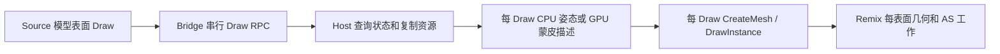
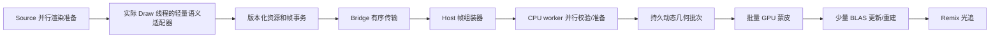

# v42 后的 RT 架构重审

日期：2026-10-25

## 决策

当前逐 Draw 的显式 Remix API 路线已经完成了它的任务：证明相机、世界、幸存者、普通感染者、武器部件、纹理、CPU/GPU 蒙皮和生命周期可以正确接入。它适合作为画面正确性的 oracle 和少量特殊对象的回退路径，不适合作为最终动态场景后端。

从 v43 起停止继续调整 64/80/96 一类额度，也不再把逐 Draw CPU 微优化当作主线。新的生产目标是“带稳定身份的帧事务 + 批量动态几何后端”：在 Source/Bridge 侧只产生有所有权的模型语义与资源版本，在 Host worker 上并行准备，在 Remix 内以稳定、可更新的动态几何批次完成 GPU 蒙皮和加速结构更新。静态世界继续使用已经通过的原生 D3D/Remix 缓存路径；现有显式 API 路径只保留为对照和不支持对象的回退。

## v42 证明了什么

GPU-80 的稳定窗口为 6.14 FPS，每帧约 674 个模型提交，其中 594 个是 CPU 姿态，580.5 个创建新 Mesh。模型路径单独占 133.37 ms/帧，已经是 24 FPS 总预算的 3.2 倍。Host 进程平均不到一个 CPU 核，说明大量工作仍沿设备命令链串行发生；与此同时 GPU-96 已出现约 85% 的 3D 中位占用和 1.68 秒 Present 等待，说明把同一种逐表面工作继续转给 Remix API GPU 蒙皮也会触顶。

这不是单一函数慢，而是工作单位错误。Source 的一个人物被拆成大量材质/表面 Draw；当前 Host 对每个 Draw 重复执行状态查询、资源读取、shader 分类、姿态准备、哈希、几何构建、Mesh 注册和实例提交。CPU 路径每帧重建，GPU 路径则让 Remix 对许多细小表面分别蒙皮并更新光追几何。两条路径都保留了过细的 Source Draw 粒度。

GPU-80 中即使把 41.67 ms/帧的 CPU 蒙皮假设为零，其他工作不变也只有约 8.26 FPS。继续优化权重循环、哈希或 Mesh 容量无法达到 24 FPS。

## 对参考路线的重新判断

### l4d2-rtx

`l4d2-rtx` 的模型主路径在 `CMeshDX8` 绘制前识别 Source 顶点格式，关闭原 vertex shader、设置 FVF/矩阵和分类状态，然后让普通 D3D9 Draw 被 Remix 捕获。它没有在 Host 为每个表面创建一份 Remix API Mesh。这一原则是正确的：尽量复用 Source 已准备的资源和 Remix 原生缓存。

它同时全局设置 `mat_softwareskin=1`、`mat_queue_mode=0`、`r_threaded_particles=0`、`r_threadeddetailprops=0` 等选项。固定功能模型之所以可用，依赖 Source 提供已经软件蒙皮的顶点。整套复制会把 CPU 蒙皮留在 Source，并失去本项目要求保留的渲染并行；因此只复用材质/格式规则和“在进入 Remix 前规范化绘制”的方法，不复用全局单线程配置或共享 `primctx`。

### Remix programmable vertex capture

Remix 的 `rtx.useVertexCapture` 会在原 vertex shader 中注入 UAV 写入，为每次可编程绘制分配捕获缓冲，并保留原始 Draw 以执行 shader。v38 全局开启后，约 558 个模型 Draw/帧使首段降至 0.31 FPS，Present 阻塞 94.77 秒，GPU P50 达 97.3%，同时产生错误坐标和花屏粒子。按 shader 白名单开启可以作为少量未知对象的兼容回退，但仍保留逐 Draw 动态几何，不能解决主体规模问题。

### 现有显式 API

它对画面语义控制最强，也已经覆盖当前测试场景。问题在于 `remixapi_MeshInfo` 的多个 surface 在运行时仍逐 surface 进入场景管理；仅把 600 次 `CreateMesh` 包成一次多 surface 调用不能消除 600 个动态表面的蒙皮/AS 工作。最终后端需要合并几何工作单位并支持持久更新，而不只是减少 API 函数调用次数。

## 目标架构

### 1. Source 语义适配器

从 `l4d2-rtx` 提取已验证的模型、材质、视图和特殊表面分类，但适配器只生成值语义数据，不直接维护跨线程的全局绘制上下文。模型开始/结束、模型或实体稳定 ID、骨骼 palette 版本、材质 ID 和实际表面 Draw 进入同一个 Source 队列顺序；消费 Draw 使用线程局部、可嵌套的作用域。`mat_queue_mode`、粒子、detail prop 和 rope 的线程 CVar 保持用户/引擎原值。

如果当前游戏 ABI 不能把高层模型身份安全带到 queued Draw，首个结构原型可用连续 Draw、world 变换和骨骼 palette 摘要形成保守批次；该摘要只用于批处理，不作为最终跨帧实体身份。正式路径必须取得生产者提供的稳定身份，不能长期依赖 Draw 顺序猜测。

### 2. Bridge 帧事务

不再为每个 Draw 重复发送或查询完整资源。静态 bind-pose 顶点、索引和材质按 `resource ID + generation` 发送一次；每帧只传实例、骨骼 palette、可变形参数和可见 surface 引用。帧结束是明确的提交边界，Reset、换图和资源失效形成 generation 屏障。

Draw 到达 Host 时只做有界校验和拥有权转移。D3D9 Device 查询及必要的动态 buffer 复制留在设备所有者线程；纯 CPU 解码、蒙皮准备、顶点拼接和索引重写交给 worker。设备线程不逐 Draw 等待 worker，worker 也不调用 D3D9。

### 3. Host 帧组装器

帧组装器把 Source 的表面 Draw 还原为较大的动态工作单位：优先按稳定实体组织骨骼与 bind pose，再按材质/透明度/cull/category 形成少量几何段。CPU oracle 路径可把顶点变换到统一空间后拼接同类段；GPU 路径把各段引用同一实体的骨骼 palette。

工作队列允许 Source/Bridge 继续处理后续 Draw，帧末只等待本帧仍未完成的必要任务。等待分别记录为前端捕获、worker 排队、worker 执行、设备提交和 GPU 完成，避免把所有空闲时间都归到 Present。

### 4. Remix 动态几何后端

在固定的 Remix runtime 分支增加内部动态几何接口。它在预热后保留 Mesh/几何身份和容量；每帧通过环形上传区更新骨骼、变形参数或合并后的顶点范围，不重复注册/销毁数百个 Mesh。GPU 蒙皮以批次执行，再按合并后的几何段更新或重建少量 BLAS。材质范围仍保持独立，人物/武器的跨帧身份和上一帧位置不因每帧新句柄而丢失。

首个实现可以先使用 worker CPU 蒙皮写入动态批次，以验证“去除逐 Draw Mesh/AS”这一结构收益；接口和身份从一开始按 GPU 蒙皮设计。验证通过后把同一批次的变形移动到 compute，不再回到当前每 surface 的 Remix API skinning。

### 5. 三条渲染路径的边界

| 内容 | 正式路径 | 原因 |
| --- | --- | --- |
| 静态世界、稳定刚体 | 原生固定功能 D3D/Remix 捕获 | 已有资源身份和缓存，避免重复复制 |
| 幸存者、感染者、武器等动态模型 | 帧组装器 + 持久动态批次 | 需要稳定身份、批量蒙皮和少量 AS 工作 |
| 尚未识别的特殊 shader/morph/粒子 | 小规模 vertex capture 或现有显式 API 回退 | 保证覆盖，同时统计其预算，不能扩散为默认路径 |
| HUD/后处理 | 光栅合成 | 不进入世界 BLAS |

## 实施顺序和一次测试设计

1. **冻结 oracle**：v42 保留为画面与输入解释对照，GPU 显式额度固定在已测最佳的 80，不再扩展。
2. **建立帧事务与批次计数**：加入资源版本、模型/骨骼批次身份、worker 时间线和“原 Draw 数 → 动态批次数 → 材质段数”统计。直接实现帧组装器，不单独发布纯采集版。
3. **CPU 动态批次结构原型**：在 worker 上并行执行现有已验证的 CPU 重建，把同类几何合并后提交。它用于证明 Draw 粒度消除，不作为最终 CPU 蒙皮方案。
4. **持久 runtime 更新接口**：让预热后的每帧 `CreateMesh` 归零，以稳定句柄更新动态范围；记录 upload、deform、BLAS 和 path-trace GPU 时间。
5. **批量 GPU 蒙皮**：使用同一帧事务和持久缓冲，把 CPU oracle 换成 compute 变形；不再逐 surface 增加 GPU skin 实例。
6. **补特殊覆盖**：按回退预算排序处理 morph、alpha、粒子、水和未知 shader；不让少数兼容路径阻塞主体性能验证。

下一份用户包只保留一次 F9 和一个 ZIP，在同一进程中完成：短 oracle 画面对照、结构后端稳定窗口、资源回收和普通 Present 生存检查。不再安排 64/80/96 三档。需要重建设备或 runtime 时由入口自动完成，用户不手动替换中间文件。

## 第一阶段硬门槛

结构原型只有同时满足以下条件才继续 GPU 化：

- 所有当前 v42 已显示的模型部件仍可见，材质和透明分类不倒退；
- 预热后不再按 Source Draw 创建 Mesh，`CreateMesh` 的稳定目标为 0/帧；
- 报告实际 Source 模型 Draw、稳定实体、动态批次、材质段和 BLAS 更新数，证明工作单位确实减少；
- Host 设备线程不执行 CPU 蒙皮，worker 至少有两个实际并行任务且时间线发生重叠；
- `mat_queue_mode` 及相关线程 CVar 没有被测试包改写；
- 结构窗口至少超过当前 6.14 FPS，并把模型关键路径压到 20 ms/帧以下；若仍达不到，先定位剩余前端/BLAS成本，不恢复逐 Draw 微调；
- 生命周期仍完成资源归零、60 个普通 Present 和可解释退出。

24 FPS 是 41.67 ms 的整帧预算，模型路径的阶段目标 20 ms 只是给路径追踪、合成和游戏本身留出余量。达到该结构门槛后再用 GPU timestamp 确定 B580 在选定分辨率与 ReSTIR 配置下的最终画质预算；当前 6 FPS 不能直接用来推断新架构的最终上限。

## 风险与停止条件

- 若高层模型身份无法在 queued 模式中可靠到达实际 Draw，优先扩展 Source 有序命令，不用 `mat_queue_mode=0` 绕过。
- 若按实体/材质合并后仍接近原来的数百个 BLAS 更新，说明需要 runtime 的多材质几何或纹理图集支持；仅减少 API 调用不算结构通过。
- 若 GPU 批量蒙皮完成后 B580 的纯路径追踪仍超过预算，届时再调整内部分辨率、采样和降噪。画面覆盖、CPU 架构和 GPU 画质预算分别下结论。
- 现有显式 API 回退必须有数量和耗时上限；一旦它重新成为多数路径，结构验收失败。

