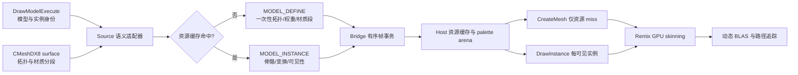
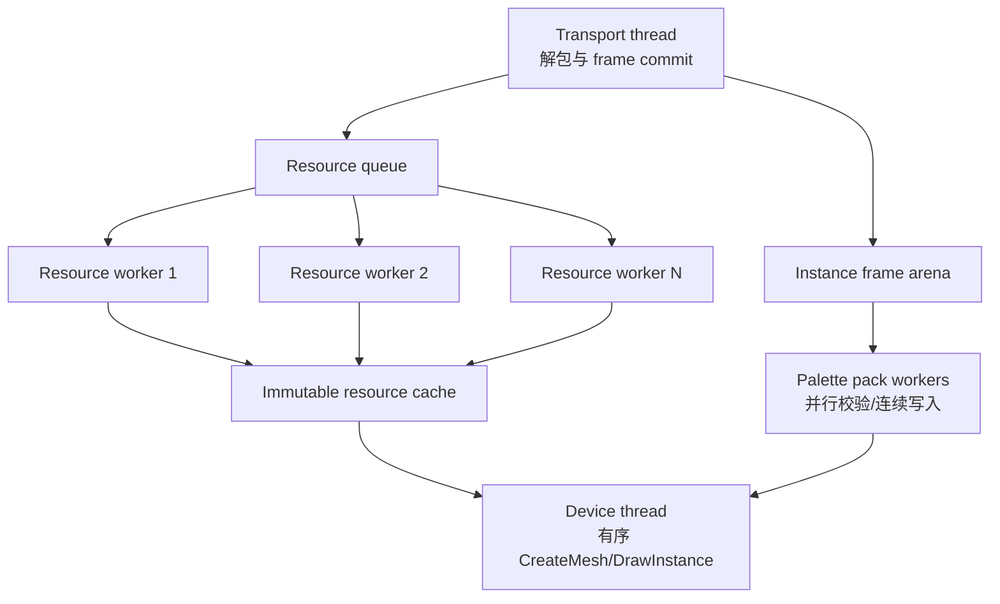

# v47 人物渲染资源／实例架构

## v47 实机结论与 v48 修正

2026-10-26 的 v47 B580 运行完成了 90 个 RT Present、资源回收和 60 个 raster Present，但模型 scope、资源定义与实例提交均为 0；同时产生 56,117 次 CPU-pose 提交。Client 只记录到“虚表项写入成功”，没有任何模型 scope。复核固定 L4D2 SDK 与 `l4d2-rtx` 后确认 slot 19 本身正确，差异在钩子方式：参考项目用 slot 19 取得 `CModelRender::DrawModelExecute` 地址后对函数入口安装 MinHook，v47 仅替换 IVModelRender 虚表项，无法覆盖引擎内部的直接函数调用。

v48 改为用 Bridge 已固定的 Microsoft Detours 对函数入口安装钩子，并在 Client 卸载前解除；控制日志分别记录入口调用、有效 palette 与拒绝数。性能路径对无 scope draw 只执行原游戏 draw，不再进入 CPU pose API Mesh 路径。资源／实例架构保持不变，下一次实机验收先要求入口调用与有效 scope 非零，再评价复用、画面和吞吐。

日期：2026-10-26

## 决策

v43–v46 的 `frame batch` 路线到此结束。正式人物路径不再逐帧生成 CPU 顶点、不再拼接几何，也不再调用 `remixapi_LdbUpdateMesh` 更新一份 CPU 变形后的大 Mesh。新主线把人物拆成两类数据：

- **模型资源**：bind-pose 顶点、索引、法线、UV、骨骼权重、骨骼索引和材质分段，只在资源首次出现或版本变化时上传；
- **模型实例**：资源 ID、实例 ID、world transform、骨骼 palette、可见分段和材质变体，每帧上传。

Remix 已经支持在 `CreateMesh` 中接收 skin weights/indices，并在 `DrawInstance` 中接收 bone transforms；runtime 也已有 GPU skinning compute。v47 首先把这条现成契约打通，而不是继续维护自定义动态 Mesh 更新协议。

v42 的“批量动态几何后端”设想被本方案取代。它虽然减少了 API 批次数，却仍然每帧在 CPU 上构造全部几何，因此没有改变主要成本。

## 实施状态

R0 数据层已于 2026-10-26 落地：`rt_model_resource.h` 提供资源定义、generation、ready/invalidate 状态机和 wire 校验；`rt_model_frame.h` 提供实例／palette wire、顺序敏感 frame commit 和三槽所有权。原生用例已执行 300 帧单资源回放和 1/8/32/64 实例扩展，并强制 `CPU posed vertices`、`CPU rewritten indices`、`compatibility fallbacks` 为零。

旧采集没有 `DrawModelExecute` 的模型／实体身份，不能诚实地把数百个旧 surface 自动还原成资源实例。R1 已增加该身份入口：32 位 Bridge 在 performance 请求出现后才挂接 `VEngineModel016::DrawModelExecute` slot 19，通过线程局部 scope 把模型路径、checksum、实体、skin/body/lod、surface 序号和 owned bone palette 关联到其内部 D3D draw。第一条 surface 携带一次 palette，其余 surface 只携带身份，避免按材质面重复复制。该阶段只观察，不改变人物绘制，也不把候选指针身份冒充跨帧稳定身份。

R2A 核对固定 runtime 后修正了两个隐藏的身份问题。Runtime 的 `DrawCallCache` 本来就会让同一拓扑的不同 palette 使用独立 BLAS 槽，所以 Host 不再为每个同时出现的 pose 添加 `pose-slot` 并复制 Mesh。Host 通过已有 `InstanceInfoObjectPickingEXT` 传递折叠后的稳定实例 ID；runtime 的外部实例 identity 在该 ID 存在时不再包含 bone hash 和 world transform。Bone hash 仍保留在 `DrawCallCache` 中决定 skinning 和 BLAS update/refit，因此稳定实例身份不会把动画误判为静态。

R2B Host 核心提供 `defineResource`／`drawResource`：一次定义严格有序的多个蒙皮 surface 及各自材质，随后用一份 palette 和稳定实例 ID 提交一次 `DrawInstance`。资源定义对顶点、索引、权重、骨骼索引、材质和 surface ordinal 计算不可变签名；同 ID 的拓扑变化会被拒绝，不能静默覆盖正在使用的资源。资源和材质继续按 fence 完成帧释放。

`rt_model_assembly.h` 实现 scope 事务：第一条任意 D3D draw 拥有 palette，后续符合条件的 surface 可以用稀疏 ordinal 加入；遇到下一 scope 或帧边界时一次性交付拥有所有权的 palette 与 surface 列表。它拒绝孤立 continuation、身份变化、乱序/重复 surface、NaN palette 和超限输入。

R2C 已完成实机 Host 接线。每条模型 draw 在 shader 分类前先进入 scope 观察器；符合条件的 surface 仅收集 bind-pose 几何和材质。下一 scope 到来时提交上一实例，最后一个 scope 由 Device/SwapChain 的 pre-Present hook 在物理 Present **之前**提交，因此不会把旧 pose 延迟到下一帧。性能模式固定关闭 `frameBatchActive()`，不创建 worker pool，并要求 CPU pose、frame batch 与兼容回退计数全部为零。

v47 验收器要求 90 个 RT Present 内资源定义数小于实例数，证明至少发生复用；每个成功 scope 恰好对应一个实例，所有 scope 必须含有效 surface 和 palette；资源失败、CPU pose、frame batch、未释放资源任一非零都会失败。三个 30 帧窗口分别记录预热、稳定和复用阶段，随后关闭 RT、等待资源清零并完成 60 个普通 Present。该接线已通过 Python 回归、便携事务用例、严格 Win64 交叉编译和固定 Bridge 补丁重放；Windows 原生 CI 与 B580 游戏运行仍未完成。

## 为什么要停止优化 `batch_assemble`

v46 的同一场景实测如下：

| 指标 | v46 实测 | 含义 |
| --- | ---: | --- |
| Source 模型 Draw | 576/帧 | 输入仍是表面粒度 |
| 顶点 | 1,063,420/帧 | 每帧重复复制 |
| 索引 | 4,079,562/帧 | 每帧重复重写 base index |
| API batch | 61/帧 | 调用数降低 9.37 倍，但数据量没有消失 |
| `batch_assemble` | 65.65 ms/帧 | 单独已超过 60 FPS 的 16.67 ms 总预算 |
| Host device thread | 48.96 ms CPU/帧 | 设备链仍接近单核串行 |
| 完整帧 | 164.1 ms，约 6.09 FPS | 与 24 FPS 仍相差很远 |
| persistent 阶段 | 5 帧后 device lost | `VK_ERROR_DEVICE_LOST`，不能作为可用后端 |

当前四个 worker 只执行 `model_input::finish` 和 `live_mesh::build`。`batch_assemble` 随后在设备线程上串行执行 `std::map` 分组、顶点插入、索引扩容和逐索引加 base。worker 的等待只有约 0.79 ms/帧，说明再增加 worker 数量不会解决 65.65 ms 的串行阶段。

即使把 `batch_assemble` 改成两遍 prefix sum、预分配和并行拷贝，它仍需每帧搬运约 100 万顶点和 400 万索引。它可以作为一次 CPU 归因实验，不能成为 60 FPS 架构。

这些数据已经足够否决当前工作单位，但还不能声称所有 CPU 时间都已完全归因。Source、Bridge、Host 和 Remix 之间是否还有长串行等待，需要 ETW 线程时间线和 GPU timestamp 才能分开。v47 把这些指标列为协议的一部分；架构决策不依赖 Windows 任务管理器中的单个“GPU 占用率”。

## 新的数据流



核心变化是把工作量从 `O(每帧顶点 + 每帧索引)` 降为 `O(可见实例 + 骨骼矩阵)`。一个 100 骨骼人物每帧约需 4.8 KiB 的 3×4 FP32 palette；这比重新传输它的全部表面顶点和索引小一个量级以上。

## Source 侧：在人物级取得稳定语义

参考 `l4d2-rtx` 已验证的两个入口：

1. `CModelRender::DrawModelExecute` 能取得 `DrawModelState_t`、`ModelRenderInfo_t` 和 `pCustomBoneToWorld`，适合定义一次人物实例作用域；
2. `cmeshdx8_renderpass_pre_draw` 能看见该人物随后绘制的各 surface、材质和真实顶点／索引绑定，适合第一次建立资源分段。

适配器使用线程局部、可嵌套的 `ModelScope`，不使用跨线程全局 `primctx`。作用域只保存拥有所有权的值：

```text
ModelResourceKey = model path/checksum
                 + studio header generation
                 + LOD + bodygroup + skin
                 + surface/material-layout generation

ModelInstanceKey = renderable/entity handle generation
                 + view kind

ModelFrameState  = instance key + resource key
                 + world transform + bone palette
                 + visible surface mask + material variants
```

`ModelRenderInfo_t` 中可用的实体／renderable 信息先作为候选身份；正式使用前必须验证死亡、重生、换图和 handle 重用。generation 随资源失效或实体重用递增，禁止仅用 Draw 顺序形成跨帧身份。

第一次遇到资源时，低层 surface hook 复制 bind-pose 数据、权重、索引和材质分段。之后相同资源只记录可见分段，不再读回 VB/IB。flex/morph 数据作为独立扩展字段；第一条纵向切片选择 morph 为零的普通感染者，先验证骨骼主路径。

本项目不复制 `l4d2-rtx` 的 `mat_queue_mode=0`、`mat_softwareskin=1` 和关闭 threaded particles/detail props 等设置。Source 原有并行配置保持不变。

## Bridge：资源消息和帧事务

协议增加四类有序消息和一个 Host 内部 ready 状态：

| 消息 | 生命周期 | 内容 |
| --- | --- | --- |
| `MODEL_DEFINE` | cache miss / generation 变化 | 资源 ID、顶点属性、权重、索引、材质分段 |
| `MODEL_READY` | Host 内部状态 | 资源 ID、generation、接受或拒绝原因；不增加反向 RPC |
| `MODEL_INSTANCE` | 每帧每实例 | 实例 ID、资源 ID、transform、palette、可见 mask |
| `MODEL_INVALIDATE` | 换图／资源重载／Reset | 资源或 generation 失效屏障 |
| `FRAME_COMMIT` | 每帧一次 | frame ID、相机、实例数量、完整性摘要 |

传输使用三槽 frame arena：Source 写 `N`，Bridge/Host 消费 `N-1`，GPU 使用更早的资源。arena 中只放连续的 POD header、matrix 数组和 ID，不为每个 Draw 分配 future 或执行同步 RPC。资源定义走独立、有界的可靠队列；Host 在资源校验和 `CreateMesh` 后将 generation 标为 ready，实例帧不能引用尚未 ready 的 generation。

背压策略很简单：资源未 ready 的实例在探索版中计为 `unsupported/awaiting_resource` 并从 RT 场景省略；不调用旧 CPU 路径。这样一次实测只能证明新架构本身，结果不会被兼容回退掩盖。

## Host 线程模型

多线程只用于可以安全并行且能减少设备线程工作的阶段：



- **Transport thread**：验证消息边界和 generation，发布完整帧；不碰 D3D9。
- **Resource workers**：只在 cache miss 时解码、校验、哈希和建立 immutable mesh descriptor。
- **Palette workers**：按实例分区验证有限数值、转换矩阵布局，并写入预分配连续 arena。
- **Device thread**：处理资源创建、相机和实例提交。D3D9 与 Remix API 调用保持单线程顺序。
- **GPU/runtime**：执行 skinning、dynamic BLAS 和 path tracing。

设备线程没有 `std::future::get()`、`std::map<Key, vector<Batch>>`、顶点 concat 或索引 rebase。帧提交只遍历已 ready 的实例描述。worker 数量按实际 CPU 核心配置，初始 `min(6, hardware_concurrency - 2)`；验收看时间线重叠和 stage CPU time，不再用 QPC wall time冒充 worker CPU time。

## Remix 主路径

仓库当前 `rt_live_mesh.h` 和固定 runtime 已经具备所需基础：

- `remixapi_MeshInfoSurfaceTriangles` 接受 `bonesPerVertex`、blend weights 和 blend indices；
- `remixapi_InstanceInfoBoneTransformsEXT` 接受实例 bone transforms；
- `rtx_geometry_utils.cpp` 已有 GPU skinning compute；
- `rtx_scene_manager.cpp` 已在提交 RT 几何前 dispatch skinning。

新 Host 对每个 `ModelResourceKey` 调一次 `CreateMesh`。同一模型的材质 surface 保留在一个 Mesh 的多个 surface 中；每个可见实体每帧只调一次 `DrawInstance` 并附带 bone transforms。主路径不再调用 `remixapi_LdbUpdateMesh`。

runtime 第一阶段只增加观测，不改 GPU 算法：

- registered skinned resources / surfaces；
- skinning dispatch 数、顶点数和 GPU timestamp；
- dynamic BLAS build / update / merged 分类；
- skinning → BLAS → trace 之间的 GPU wait；
- device lost 前最后一个资源、实例和提交序号。

如果 Remix API 的多 surface Mesh 最终仍按数百 surface 建立独立 BLAS，第二阶段才在 runtime 内增加“同一 skinned resource 多材质 range 聚合”。这项决策以第一阶段计数为依据，不提前维护另一套几何协议。

## 兼容路径策略

探索版只运行新路径。旧显式 API、CPU pose 和 v46 batch 代码保留为离线画面 oracle，由单独模式启动，不能在同一个性能窗口回退。每个被省略对象必须按 shader、model、surface 和原因计数。

通过人物主路径后，再逐类加入 rigid attachment、viewmodel、alpha、flex/morph 和特殊感染者。每一类要么进入资源／实例协议，要么明确留在普通光栅合成；不会用无上限的逐 Draw fallback 填满场景。

## 三种方案比较

| 方案 | 预计收益 | 实现风险 | 结论 |
| --- | --- | --- | --- |
| 继续并行 `batch_assemble` | 可降低一部分 65.65 ms；仍每帧复制全部几何 | 低 | 只作归因对照，停止作为主线 |
| **资源一次上传 + 每帧实例／骨骼 + Remix GPU skinning** | 直接消除 CPU pose、concat、index rewrite 和每帧 Mesh 更新 | 中 | **v47 主方案** |
| 完全自定义 runtime model registry / GPU buffer 协议 | 控制力最高，可跨实例聚合 skin/BLAS | 高 | 主方案实测证明 API 粒度仍是瓶颈后再启动 |
| 完整照搬 `l4d2-rtx` 固定功能路径 | 接入代码较少 | 会带回软件蒙皮和单线程配置依赖 | 不符合保留多线程的目标 |

主方案的可行性高于 v42：所需人物身份和 palette 入口已在 `l4d2-rtx` 使用；权重、骨骼索引和矩阵已被本项目实际采集并验证；Remix API 和 runtime 已实现相应 GPU skinning 数据契约。主要未知量从“能否传入数据”收敛为“每个资源在 Remix 中产生多少 GPU skin/BLAS 工作”。

## 开发分段与一次验收

### R0：协议和身份回放

实现资源／实例消息、generation、frame arena 和无 fallback 计数。使用现有采集数据离线回放，验证一个模型只产生一个资源定义、每个实例每帧一份 palette；不生成测试包。

### R1：单个普通感染者纵向切片

接入 `DrawModelExecute` scope 和 surface 资源定义；Host 使用现成 Remix GPU skinning contract。固定相机运行 300 帧。验收必须同时满足：

- 预热后 `CreateMesh = 0/帧`；
- `CPU posed vertices = 0`、`CPU rewritten indices = 0`；
- `batch_assemble` 不存在于 profile；
- 一只感染者全部部件、衣服颜色和动画可见；
- 300 帧无 device lost；
- runtime 证明发生 GPU skinning dispatch 和 dynamic BLAS 工作。

### R2：同进程扩展测试

一次 F9 依次运行 1、8、32、64 个相同模型实例，每段 180 帧。一个结果 ZIP 同时报告：

- Source capture、Bridge、Host device thread 和 GPU 各阶段 P50/P95；
- 每帧协议字节、实例、骨骼、资源 miss、surface、skin dispatch、BLAS build/update；
- CPU 各线程实际 CPU time 与调度等待；
- GPU skinning、AS、trace 的 timestamp；
- 画面读回和生命周期归零。

硬门槛：Host 人物 CPU P95 小于 4 ms，预热后拓扑上传为 0，64 实例仍无 device lost。若同场景相对 v46 不能达到至少 2 倍帧率，停止扩大材质覆盖，先依据 GPU timestamp 判断 surface/BLAS 粒度是否需要 runtime 聚合。

### R3：高压实机场景

R2 通过后才回到完整测试地图。第一目标是稳定超过 24 FPS 并保持完整人物；随后分别优化 BLAS、路径追踪分辨率和采样以逼近 60 FPS。覆盖和性能仍合并成一次采集，但不会在结构门槛前发布 beta。

## 实现文件边界

第一批代码按下列边界落地：

| 位置 | 改动 |
| --- | --- |
| LDB x86 client patch | `DrawModelExecute` scope、稳定候选 ID、owned palette、surface 资源事件 |
| `integration/rt/rt_protocol.h` | 资源／实例／失效／frame commit 消息和 generation |
| 新 `integration/rt/rt_model_resource.h` | immutable resource descriptor、key、校验和 cache 状态机 |
| 新 `integration/rt/rt_model_frame.h` | triple arena、实例／palette packing、完整性摘要 |
| `integration/rt/rt_host.h` | 消费资源与实例事务，不从逐 Draw 回建人物 |
| `integration/rt/rt_live_mesh.h` | 资源级 `CreateMesh` 和实例级 `DrawInstance` 接口 |
| runtime patch | skinning/BLAS GPU telemetry；暂不增加自定义更新 API |
| `rt_world_runtime.cpp` | R1/R2 阶段控制、读回、生命周期和失败归因 |

`rt_model_batch.h` 在 R1 通过后从生产构建移除；在此之前仅供 v46 离线对照。这样可以先用一个普通感染者验证最关键的 Source → Bridge → Host → Remix 纵向路径，再删除旧实现，避免同时改完所有覆盖后才发现实例身份或 Remix surface 粒度不成立。

## 止损条件

- 若 queued rendering 下无法把稳定模型／实例身份与实际 surface 关联，扩展 Source 有序命令传值；不通过关闭 `mat_queue_mode` 解决。
- 若一份多 surface skinned resource 在 runtime 仍产生接近原 Draw 数的独立 BLAS，转入 runtime 内资源级 geometry range 聚合；不回到 CPU batch。
- 若 GPU skinning和 BLAS 合计已经低于 8 ms、整帧仍远低于目标，则瓶颈已经转到路径追踪／Present，后续按 GPU timestamp 调整画质预算。
- 若 R2 的 64 实例仍 device lost，先最小化到触发资源／surface，修复 runtime 生命周期；不以降低人物数量作为通过。

这套方案首先证明“资源一次上传、人物每帧只更新骨骼”能否在 B580 上成立。它把 v46 已定性的 CPU 结构成本从设计上删除，并把剩余风险集中到少数可以用计数和 GPU timestamp 直接回答的问题。
