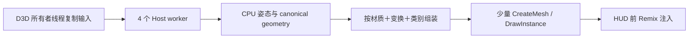

# RT Performance v43：四 worker 帧批处理原型

日期：2026-10-25

v43 是架构重审后的第一个可运行实现。它不再调整每帧 64／80／96 个 GPU 蒙皮 surface 的额度，而是在同一次 F9 中保留 30 帧 GPU-80 旧路径 oracle，再运行 30 帧批处理预热和 30 帧批处理稳定窗口，最后关闭 RT、回收资源并完成 60 个普通 Present。

## 已实现的数据路径

设备所有者线程仍负责 D3D9 状态查询、动态 buffer 复制、纹理取得和原 Draw。取得所有权的输入进入固定四线程 Host worker 池；worker 只执行纯 CPU shader 解释、姿态重建、法线／拓扑准备，不调用 D3D9。HUD 注入光追之前，设备线程等待本帧未完成任务，并按完整材质属性、世界变换、cull 和渲染类别合并 canonical triangle geometry。

CPU 蒙皮人物已经处于统一世界空间，因此同材质的大量身体 surface 可以拼成一个批次；刚体只合并世界变换完全相同的 surface。每批限制为 262,144 顶点和 786,432 索引，防止一个异常组无限增长。每个成功批次只执行一次 `CreateMesh` 和一次 `DrawInstance`，原 Source Draw 的 Ignore 分类和物理光栅 Draw 保留。

计时窗口已经改为线程局部，worker 不会与设备线程争写 profiling counter。worker 的提交、完成、失败、最大同时活跃数和累计 QPC 时间另行记录。批处理任何一步失败都会停止 RT；它不会把缺失人物当作性能成功。

## 一次测试同时证明什么

v43 使用两套账本。Source 账本要求 60 个批处理帧的每个输入 Draw 都完成 worker 重建并进入某个成功批次；API 账本记录实际 Mesh／Instance 批次数。验收要求：

- 60 个批处理帧均有模型输入，`submitted_source_draws == source_draws`；
- worker 提交数、完成数和最终 Source Draw 总数完全一致，失败为零；
- 四个 worker 已建立，至少两个实际同时工作；
- API 批次总数严格小于 Source Draw 总数；
- `api_mesh_frame` 的累计提交增量与每窗口批次数完全一致；
- GPU-80 oracle、批处理预热、批处理稳定三个 30 帧计时窗口完整；
- RT 资源归零后继续 60 个普通 Present。

分析报告给出两个批处理窗口各自的 FPS、Source Draw、API 批次数、压缩率、前端捕获时间、帧末等待、组装和提交时间，并继续关联 Arc 3D engine 采样。用户仍只需进图、保持普通感染者／人物在画面内并按一次 F9，最后上传一个 ZIP。

## 本版边界

v43 直接移除了大量逐 surface CPU 重建和 API 调用，但批次 Mesh 仍是每帧创建并在 fence 后销毁。它用于回答两个关键问题：worker 并行是否能降低设备线程时间，以及按材质／变换合并后真实工作单位能缩小多少。它还不是最终的持久动态几何后端，也没有宣称达到 24 FPS。

若 v43 保持完整显示并明显超过 6.14 FPS，下一版将在固定 Remix runtime 分支加入稳定批次句柄和动态范围更新，让预热后的 `CreateMesh` 降到零。若 FPS 没有明显增长，v43 的分段时间会区分剩余瓶颈在 D3D 输入复制、帧末 worker 等待、批次提交还是 Remix 的动态 BLAS，从而直接决定 runtime 接口的实现重点。
